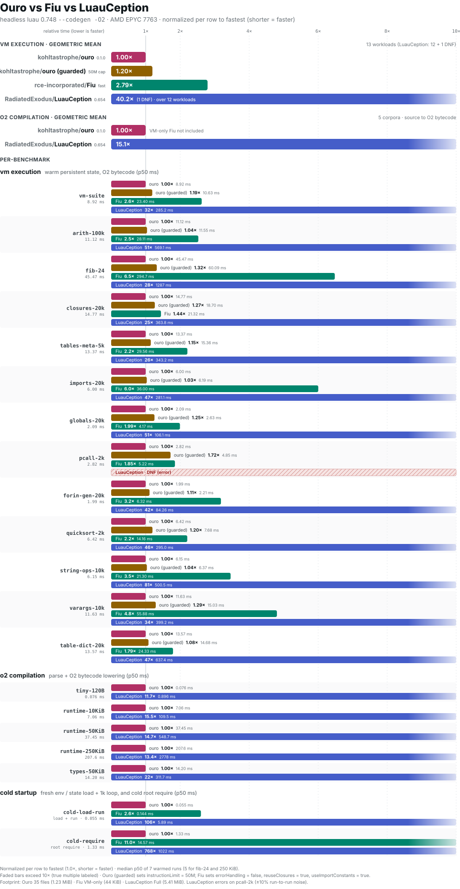
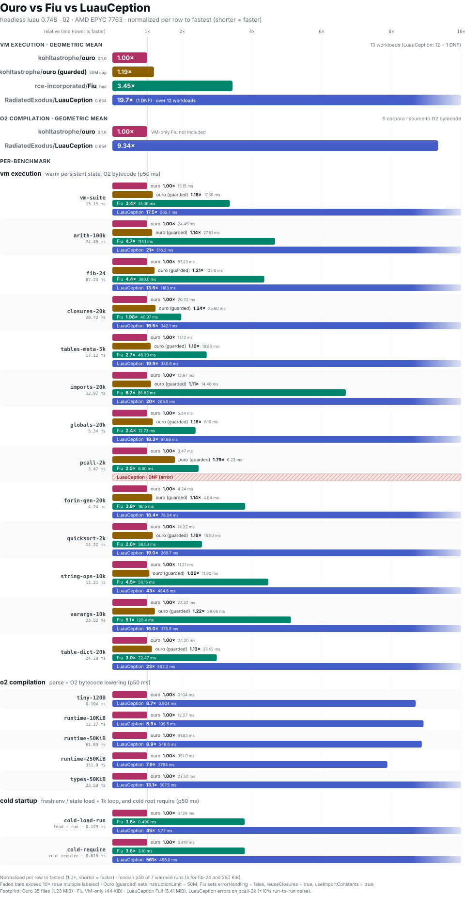

# Benchmarks

The [`Benchmarks` workflow](https://github.com/kohltastrophe/ouro/actions/workflows/benchmark.yml) runs sequentially on Ubuntu runners under headless `luau 0.748` across both `--codegen -O2` (matching Roblox native codegen) and `-O2` interpreter execution. Before timing any workload, [`docs/benchmarks/bench.py`](https://github.com/kohltastrophe/ouro/blob/main/docs/benchmarks/bench.py) runs `--verify` to confirm exact output parity against host Luau `loadstring`.

## Results

<Tabs>
<TabItem value="codegen" label="Native Codegen (--codegen -O2)" default>

[](https://raw.githubusercontent.com/kohltastrophe/ouro/assets/chart.svg)

</TabItem>
<TabItem value="interp" label="Interpreter (-O2)">

[](https://raw.githubusercontent.com/kohltastrophe/ouro/assets/chart-interp.svg)

</TabItem>
</Tabs>

Raw timing, cold-require, and code-footprint metrics are published alongside the SVG charts in [`results.json`](https://raw.githubusercontent.com/kohltastrophe/ouro/assets/results.json) on the `assets` branch.

## Capabilities

| Capability | Ouro | Fiu | LuauCeption (`0.654`) |
| :--- | :--- | :--- | :--- |
| **Lexer & lossless AST** | Yes (`reconstruct()` exact bytes) | No | C++/WASM only |
| **Luau `0.748` bytecode compiler (`O0`–`O2`)** | Yes (pure Luau) | No | Luau `0.654` via WASM |
| **Bytecode disassembler & verifier** | Yes (`v3`–`v14` verified) | Deserializes only | C++/WASM only |
| **Sandboxed register VM** | Dual `@native` fast / guarded | Interpreter loop | WASM C VM (`lua_State`) |
| **Instruction, call, time & memory limits** | Yes (`LoadOptions` + `ResourceLimits`) | Custom hooks only | Custom C setup |
| **Per-environment RNG & `getGlobal`/`setGlobal`** | Built-in (`PCG32`) | Manual metatable env | Manual metatable env |
| **Runtime architecture** | Pure `--!strict` Luau | Pure Luau | Emscripten WASM in Luau |

## What's Measured

Every run exercises four stages defined in [`docs/benchmarks/run.luau`](https://github.com/kohltastrophe/ouro/blob/main/docs/benchmarks/run.luau):

- **Warm VM execution (`13` workloads):** Mixed loops and coroutines (`vm-suite`), `100k` arithmetic (`arith-100k`), recursive `fib(24)` (`fib-24`), `20k` upvalue closures (`closures-20k`), `5k` metatable method calls (`tables-meta-5k`), `20k` math fastcalls (`imports-20k`), `20k` global reads and writes (`globals-20k`), `2k` throwing `pcall` frames (`pcall-2k`), `20k` `ipairs` scans (`forin-gen-20k`), `2,000`-element quicksort (`quicksort-2k`), `10k` string formatting (`string-ops-10k`), `10k` `select` vararg calls (`varargs-10k`), and `20k` dictionary field updates (`table-dict-20k`).
- **O2 compilation (`5` corpora):** Full source-to-`O2` bytecode timing across `tiny-120B`, `runtime-10KiB`, `runtime-50KiB`, `runtime-250KiB`, and `types-50KiB` (measuring Ouro's lexer, parser, compiler, and full compile against LuauCeption's WASM compiler), plus Ouro bytecode `deserialize` and `loadBytecode` latency across `10–250 KiB`.
- **Cold load + run (`cold-load-run`):** Fresh environment or VM state per invocation followed by a `1k` arithmetic loop.
- **Cold root `require` (`cold-require`):** Subprocess `require` latency comparing Ouro's lazy facade against eager competitor modules (`Fiu/Source.lua` and `LuauCeption/Full.luau`), plus Ouro's incremental lazy module loads (`VM`, `Parser`, `Compiler`).

## Methodology

- **Sampling:** Warmed median (`p50`) over `7` runs (`5` for `fib-24` and `runtime-250KiB`; `9` for `cold-load-run`; `3` subprocess samples for `cold-require`). Treat gaps under roughly `10%` as run-to-run microbenchmark variance.
- **Fair sandbox configuration:** Ouro executes in its default isolated environment (`VM.createEnvironment()`), with `Ouro (guarded)` enforcing `instructionLimit = 50_000_000`. `Fiu (fast)` configures `errorHandling = false`, `reuseClosures = true`, `vectorCtor = vector.create`, and static `useImportConstants = true` on all non-global workloads. `LuauCeption` runs inside `luaL_sandbox(L)` on all non-global workloads.
- **Handling `pcall-2k`:** LuauCeption throws `Infinity` in WASM C++ exception handling when guest errors unwind inside `pcall` (`pcall-2k`). Its bar renders as `DNF (error)` on the full charts, and its VM geometric mean averages the `12` completed workloads without adding an arbitrary timeout penalty.
- **Per-row normalization:** Geometric means normalize each row to its fastest completed entry (`1.0×`). Bars exceeding `10×` fade out cleanly and print the true multiple.

## Reproducing

Run parity verification or the self-contained Ouro suite locally without third-party dependencies:

```sh
python3 docs/benchmarks/bench.py --verify
luau --codegen -O2 docs/benchmarks/run.luau
```

Or run the sequential 3-way runner against pinned local copies of [Fiu](https://github.com/rce-incorporated/Fiu) and [LuauCeption](https://github.com/RadiatedExodus/LuauCeption) to produce `results.json` and render `chart-small.svg`, `chart.svg`, and `chart-interp.svg`:

```sh
python3 docs/benchmarks/bench.py --verify --fiu /path/to/Fiu/Source.lua --luauception /path/to/luauception
python3 docs/benchmarks/bench.py --fiu /path/to/Fiu/Source.lua --luauception /path/to/luauception
python3 docs/benchmarks/chart.py
```
