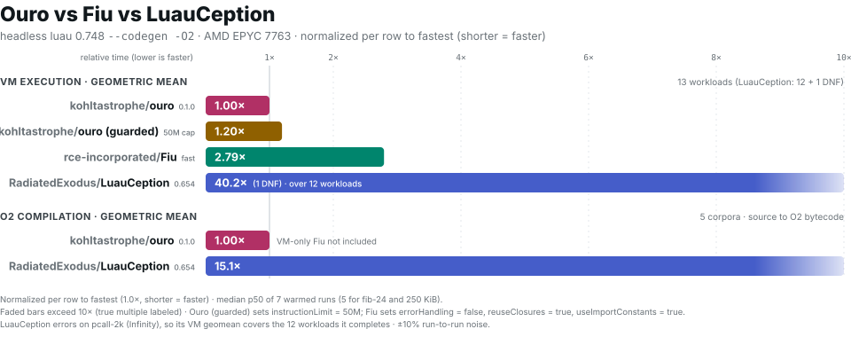

## Parse <span>without loss</span>

[`Ouro.parse`](/api/Ouro#parse) lowers Luau syntax, type annotations, and `.d.luau` declarations into flat numeric arenas with zero-based byte offsets. Enable `lossless = true` to retain comments and whitespace for exact `reconstruct()` output, or walk nodes without table allocations. See [Parsing & AST](/guide/pipeline/parsing).

```luau
local Ouro = require("./ouro")

local source = "-- keep comments\nlocal x: number = 20 + 22\nreturn x"
local parsed = Ouro.parse(source, { profile = "studio", lossless = true })

if parsed.status == "ok" then
	print(parsed:kindName(parsed.root)) -- "AstStatBlock"
	assert(parsed:reconstruct() == source)
end
```

## Compile <span>to Luau bytecode</span>

[`Ouro.compile`](/api/Ouro#compile) emits binary Luau bytecode (`v14` default, `v100` for classes) across optimization levels `0`, `1`, and `2` with constant folding, builtin fastcalls, inlining, and loop specialization. [`Ouro.Bytecode`](/api/Bytecode) includes `serialize`, `deserialize`, `verify` (`v3`–`v14`), and `disassemble`. See [Compiling & Bytecode](/guide/pipeline/compiling).

```luau
local bytecode = assert(Ouro.compile("local a, b = ...\nreturn a * b + 2", {
	optimizationLevel = 2,
}))

print(Ouro.Bytecode.disassemble(bytecode))
```

## Execute <span>in a sandbox</span>

[`Ouro.load`](/api/Ouro#load) runs source strings, binary bytecode, or decoded `ProtoModule` tables inside an isolated register VM (`inheritHost = false` by default). Set instruction, call, timeout, string, and table limits, intercept globals with `getGlobal` / `setGlobal`, and attach debugger callbacks through [`Ouro.VM`](/api/VM). See [Sandboxed VM](/guide/pipeline/vm).

```luau
local base = Ouro.VM.createEnvironment({ answer = 40 }, { readOnly = true })
local env = Ouro.VM.sandbox(base)
local chunk = assert(Ouro.load("return answer + 2", {
	name = "=example",
	env = env,
	instructionLimit = 100_000,
	timeout = 1,
}))

print(chunk()) -- 42
```

## Run fast <span>in pure Luau</span>

Dual `@native` fast and guarded dispatch loops keep unguarded execution at full speed while enforcing budgets and debug hooks only when configured, paired with lazy submodule loading on startup. See [Benchmarks](/guide/benchmarks) for `--codegen -O2` and `-O2` breakdowns against Fiu and LuauCeption.

<a href="/guide/benchmarks"></a>
