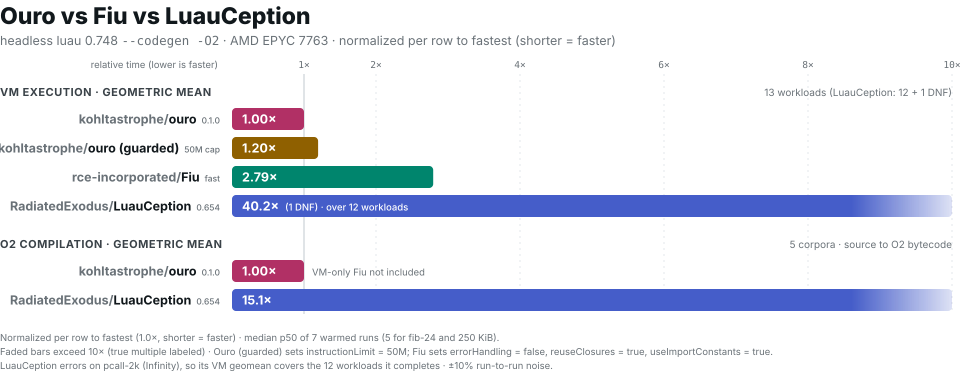

<div align="right">
<a href="https://ouro.kohl.gg"></a>
<a href="https://ouro.kohl.gg"><picture><source media="(prefers-color-scheme: dark)" srcset="https://raw.githubusercontent.com/kohltastrophe/ouro/main/.github/img/link-docs-dark.svg"></picture></a>
<a href="https://ouro.kohl.gg/guide/benchmarks"><picture><source media="(prefers-color-scheme: dark)" srcset="https://raw.githubusercontent.com/kohltastrophe/ouro/main/.github/img/link-benchmarks-dark.svg"></picture></a>
<a href="https://github.com/kohltastrophe/ouro/releases"><picture><source media="(prefers-color-scheme: dark)" srcset="https://raw.githubusercontent.com/kohltastrophe/ouro/main/.github/img/link-download-dark.svg"></picture></a>
<a href="https://discord.gg/kohl"><picture><source media="(prefers-color-scheme: dark)" srcset="https://raw.githubusercontent.com/kohltastrophe/kohltastrophe/main/.github/img/link-discord-dark.svg"></picture></a>
</div>
<br/>
<br/>
<br/>
<br/>

<div align="center">

# Parse. Compile. Execute.

_Ouro is a self-hosted Luau 0.748 lexer, lossless parser, bytecode compiler, and sandboxed register VM written in pure `--!strict` Luau. It runs on Roblox and standalone Luau without FFI, `loadstring`, or native code-loading services._

[](https://github.com/kohltastrophe/ouro/actions/workflows/ci.yml) [](https://github.com/kohltastrophe/ouro/actions/workflows/ci.yml) [](https://github.com/kohltastrophe/ouro/actions/workflows/benchmark.yml) [](https://github.com/kohltastrophe/ouro/actions/workflows/upstream.yml) [](https://github.com/kohltastrophe/ouro/blob/main/UPSTREAM.json) [](https://github.com/kohltastrophe/ouro/blob/main/LICENSE.md) [](https://github.com/kohltastrophe/ouro/releases)

---

<picture>
  <source media="(prefers-color-scheme: dark)" srcset="https://raw.githubusercontent.com/kohltastrophe/ouro/main/.github/img/h3-parse-dark.svg">
  
</picture>

<div align="left">

[`Ouro.parse`](https://ouro.kohl.gg/api/Ouro#parse) lowers Luau syntax, type annotations, and `.d.luau` declarations into flat numeric arenas with zero-based byte offsets. Enable `lossless = true` to preserve comments and whitespace for `reconstruct()`, or materialize nested node tables with [`Ouro.Ast.toTables`](https://ouro.kohl.gg/api/Ast#totables).

```luau
local Ouro = require("./ouro")

local source = "-- keep comments\nlocal x: number = 20 + 22\nreturn x"
local parsed = Ouro.parse(source, { profile = "studio", lossless = true })

if parsed.status == "ok" then
	print(parsed:kindName(parsed.root)) -- "AstStatBlock"
	assert(parsed:reconstruct() == source)
end
```

See [Parsing & AST](https://ouro.kohl.gg/guide/pipeline/parsing) for `Profiles`, reusable `ParserContext` pools, expressions, and types.

</div>

---

<picture>
  <source media="(prefers-color-scheme: dark)" srcset="https://raw.githubusercontent.com/kohltastrophe/ouro/main/.github/img/h3-compile-dark.svg">
  
</picture>

<div align="left">

```luau
local bytecode = assert(Ouro.compile("local a, b = ...\nreturn a * b + 2", {
	optimizationLevel = 2,
}))

print(Ouro.Bytecode.disassemble(bytecode))
```

[`Ouro.compile`](https://ouro.kohl.gg/api/Ouro#compile) emits binary Luau bytecode (`v14` default, `v100` for classes) across optimization levels `0`, `1`, and `2`, matching upstream constant folding, builtin fastcalls, inlining, and loop specialization. [`Ouro.Bytecode`](https://ouro.kohl.gg/api/Bytecode) includes `serialize`, `deserialize`, `verify` (`v3`–`v14`), and `disassemble`. See [Compiling & Bytecode](https://ouro.kohl.gg/guide/pipeline/compiling).

</div>

---

<picture>
  <source media="(prefers-color-scheme: dark)" srcset="https://raw.githubusercontent.com/kohltastrophe/ouro/main/.github/img/h3-execute-dark.svg">
  
</picture>

<div align="left">

```luau
local base = Ouro.VM.createEnvironment({ answer = 40 }, { readOnly = true })
local env = Ouro.VM.sandbox(base)
local chunk = assert(Ouro.load("return answer + 2", {
	name = "=example",
	env = env,
	instructionLimit = 100_000,
	timeout = 1,
}))

print(chunk()) -- 42
```

[`Ouro.load`](https://ouro.kohl.gg/api/Ouro#load) runs source strings, binary bytecode, or decoded `ProtoModule` tables in an isolated register VM (`inheritHost = false` by default). Enforce instruction, call, timeout, string, and table allocation caps, intercept reads and writes via `getGlobal` / `setGlobal`, and attach debugger hooks through [`Ouro.VM`](https://ouro.kohl.gg/api/VM). See [Sandboxed VM](https://ouro.kohl.gg/guide/pipeline/vm).

</div>

---

<picture>
  <source media="(prefers-color-scheme: dark)" srcset="https://raw.githubusercontent.com/kohltastrophe/ouro/main/.github/img/h3-fast-dark.svg">
  
</picture>

<a href="https://ouro.kohl.gg/guide/benchmarks">
  
</a>

<div align="left">

Ouro pairs dual `@native` fast and guarded VM dispatch loops with lazy submodule loading: root `require` loads types and a thin facade, deferring `Parser`, `Compiler`, `Bytecode`, and `VM` until accessed. The `Benchmarks` workflow verifies host parity across every workload before timing `--codegen -O2`, `-O2` interpreter execution, O2 compilation, and cold startup against `Fiu` and `LuauCeption`. See [Benchmarks](https://ouro.kohl.gg/guide/benchmarks) for full charts and methodology.

</div>

</div>

---

## Batteries Included

- **Arena parser & lossless reconstruction:** Parse scripts, expressions, type packs, and `.d.luau` files, reuse `ParserContext` buffers across parses, filter tokens and comments, and traverse ASTs via [`Ouro.parse`](https://ouro.kohl.gg/api/Ouro#parse) and [`Ouro.Ast`](https://ouro.kohl.gg/api/Ast).
- **Grammar profiles & strict flags:** Switch between `upstream`, `studio`, and `experimental` presets or toggle individual syntax flags via [`Ouro.Profiles`](https://ouro.kohl.gg/api/Profiles).
- **Full O0–O2 bytecode compiler:** Inline functions, fold builtins and constants, emit vector, native, and usercall fastcalls, and serialize or verify bytecode (`v3`–`v14`, `v100` classes) through [`Ouro.Compiler`](https://ouro.kohl.gg/api/Compiler) and [`Ouro.Bytecode`](https://ouro.kohl.gg/api/Bytecode).
- **Isolated sandboxed VM:** Execute compiled closures in isolated globals with `PCG32` per-environment `math.random` state, instruction/call/time/allocation caps, coverage tracking, and stack/upvalue debuggers via [`Ouro.VM`](https://ouro.kohl.gg/api/VM).

## Installation

Install `kohltastrophe/ouro` with [Wally](https://wally.run) or [pesde](https://pesde.dev) (`pesde add kohltastrophe/ouro`), download `Ouro.rbxm` or `Ouro-<version>-package.zip` from [GitHub Releases](https://github.com/kohltastrophe/ouro/releases) and place the module in `ReplicatedStorage`, sync `src` directly with Rojo, or pull the runtime-only [`dist` branch](https://github.com/kohltastrophe/ouro/tree/dist) via `git subtree`. Standalone Luau callers can require the repository root directly (`require("./ouro")`).

Read **[Getting Started](https://ouro.kohl.gg/guide/introduction/getting-started)** or browse the **[API Reference](https://ouro.kohl.gg/api/)** to parse, compile, and sandbox your first chunk.

## Acknowledgments

Ouro translates lexer, parser, compiler, bytecode, and VM algorithms and confusable mappings from official [Luau](https://github.com/luau-lang/luau), pinned to `0.748` ([`3d91c9d`](https://github.com/luau-lang/luau/tree/3d91c9d5c280c95bfc4be63aac46012cf861d394)) in [`UPSTREAM.json`](https://github.com/kohltastrophe/ouro/blob/main/UPSTREAM.json). Arena storage, public APIs, the lossless lexical tape, and coroutine checkpointing are adaptations for this pure-Luau port.

## Sponsors

Ouro is free and [MIT-licensed](https://github.com/kohltastrophe/ouro/blob/main/LICENSE.md). If Ouro is useful to you or your team, you can support its development through [GitHub Sponsors](https://github.com/sponsors/kohltastrophe) or [Ko-fi](https://ko-fi.com/kohltastrophe).

<div align="center">
  <a href="https://github.com/sponsors/kohltastrophe"></a>&nbsp;&nbsp;<a href="https://ko-fi.com/kohltastrophe"></a>
  <a href="https://github.com/sponsors/kohltastrophe"></a>
</div>
