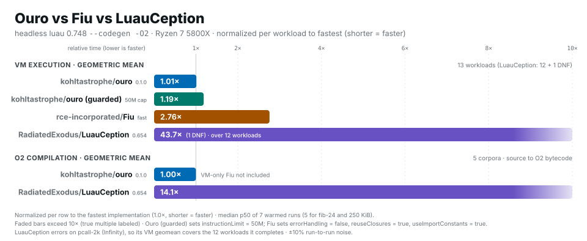

<div align="right">
<a href="https://ouro.kohl.gg"><picture><source media="(prefers-color-scheme: dark)" srcset="https://raw.githubusercontent.com/kohltastrophe/ouro/main/.github/img/link-docs-dark.svg"></picture></a>&nbsp;<a href="https://ouro.kohl.gg/guide/benchmarks"><picture><source media="(prefers-color-scheme: dark)" srcset="https://raw.githubusercontent.com/kohltastrophe/ouro/main/.github/img/link-benchmarks-dark.svg"></picture></a>&nbsp;<a href="https://github.com/kohltastrophe/ouro/releases"><picture><source media="(prefers-color-scheme: dark)" srcset="https://raw.githubusercontent.com/kohltastrophe/ouro/main/.github/img/link-download-dark.svg"></picture></a>&nbsp;<a href="https://discord.gg/kohl"><picture><source media="(prefers-color-scheme: dark)" srcset="https://raw.githubusercontent.com/kohltastrophe/kohltastrophe/main/.github/img/link-discord-dark.svg"></picture></a>
</div>

<div align="center">

# Parse. Compile. Execute.

Ouro is a self-hosted Luau 0.748 lexer, lossless parser, bytecode compiler, and sandboxed register VM written in pure `--!strict` Luau. It runs on Roblox and standalone Luau without FFI, `loadstring`, or native code-loading services.

[](https://github.com/kohltastrophe/ouro/actions/workflows/ci.yml) [](https://github.com/kohltastrophe/ouro/actions/workflows/ci.yml) [](https://github.com/kohltastrophe/ouro/actions/workflows/upstream.yml) [](https://github.com/kohltastrophe/ouro/blob/main/UPSTREAM.json) [](https://github.com/kohltastrophe/ouro/blob/main/LICENSE.md) [](https://github.com/kohltastrophe/ouro/releases)

</div>

---

<div align="center">

<picture>
  <source media="(prefers-color-scheme: dark)" srcset="https://raw.githubusercontent.com/kohltastrophe/ouro/main/.github/img/h3-parse-dark.svg">
  
</picture>

<div align="left">

[`Ouro.parse`](https://ouro.kohl.gg/api/Ouro#parse) lowers Luau syntax, type annotations, and `.d.luau` declarations into flat numeric arenas with zero-based byte offsets. Enable `lossless = true` to preserve comments and whitespace for `reconstruct()`, or materialize nested node tables with [`Ouro.Ast.toTables`](https://ouro.kohl.gg/api/Ast#totables).

```luau
local Ouro = require("./ouro")

local source = "-- keep comments\nlocal x: number = 20 + 22\nreturn x"
local parsed = Ouro.parse(source, { profile = "studio", lossless = true })

if parsed.status == "ok" then
	print(parsed:kindName(parsed.root)) -- "AstStatBlock"
	assert(parsed:reconstruct() == source)
end
```

See the [Parsing guide](https://ouro.kohl.gg/guide/pipeline/parsing) for `Profiles`, reusable `ParserContext` pools, expressions, and types.

</div>

---

<picture>
  <source media="(prefers-color-scheme: dark)" srcset="https://raw.githubusercontent.com/kohltastrophe/ouro/main/.github/img/h3-compile-dark.svg">
  
</picture>

<div align="left">

```luau
local bytecode = assert(Ouro.compile("local a, b = ...\nreturn a * b + 2", {
	optimizationLevel = 2,
}))

print(Ouro.Bytecode.disassemble(bytecode))
```

[`Ouro.compile`](https://ouro.kohl.gg/api/Ouro#compile) emits binary Luau bytecode (`v14` default, `v100` for classes) across optimization levels `0`, `1`, and `2`, matching upstream constant folding, builtin fastcalls, inlining, and loop specialization. [`Ouro.Bytecode`](https://ouro.kohl.gg/api/Bytecode) includes `serialize`, `deserialize`, `verify` (`v3`–`v14`), and `disassemble`. See the [Compiling guide](https://ouro.kohl.gg/guide/pipeline/compiling).

</div>

---

<picture>
  <source media="(prefers-color-scheme: dark)" srcset="https://raw.githubusercontent.com/kohltastrophe/ouro/main/.github/img/h3-execute-dark.svg">
  
</picture>

<div align="left">

```luau
local base = Ouro.VM.createEnvironment({ answer = 40 }, { readOnly = true })
local env = Ouro.VM.sandbox(base)
local chunk = assert(Ouro.load("return answer + 2", {
	name = "=example",
	env = env,
	instructionLimit = 100_000,
	timeout = 1,
}))

print(chunk()) -- 42
```

[`Ouro.load`](https://ouro.kohl.gg/api/Ouro#load) runs source strings, binary bytecode, or decoded `ProtoModule` tables in an isolated register VM (`inheritHost = false` by default). Enforce instruction, call, timeout, string, and table allocation limits, intercept reads and writes via `getGlobal` / `setGlobal`, and attach debugger hooks through [`Ouro.VM`](https://ouro.kohl.gg/api/VM). See the [Sandboxed VM guide](https://ouro.kohl.gg/guide/pipeline/vm).

</div>

---

<picture>
  <source media="(prefers-color-scheme: dark)" srcset="https://raw.githubusercontent.com/kohltastrophe/ouro/main/.github/img/h3-fast-dark.svg">
  
</picture>

<a href="https://ouro.kohl.gg/guide/benchmarks">
  
</a>

<div align="left">

Ouro pairs dual `@native` fast/guarded VM dispatch loops with lazy submodule loading: root `require` loads types and a thin facade in `0.86 ms` under `--codegen -O2` (`0.68 ms` under `-O2`), deferring `Parser`, `Compiler`, `Bytecode`, and `VM` until accessed.

Under headless `luau 0.748 --codegen -O2` on a Ryzen 7 5800X, Ouro leads all `13` VM workloads (`1.01×` geometric mean unguarded, `1.19×` with a `50M`-instruction cap) compared with `2.76×` (`1.36×`–`7.73×`) on `Fiu` (`fast`) and `43.69×` (`14.12×`–`82.42×`) on `LuauCeption` (`12` completed, `1 DNF` on `pcall-2k`), and compiles `5` source corpora `11.38×`–`20.03×` faster (`14.12×` geometric mean). Under `-O2` interpreter execution, Ouro records `1.00×` (`1.16×` guarded) vs `3.68×` on `Fiu` (`fast`) and `16.92×` on `LuauCeption` (`12` completed, `1 DNF`), and compiles `8.45×` faster.

| Metric | Ouro (`0.1.0`) | Fiu (`fast`) | LuauCeption (`0.654`) |
| :--- | :--- | :--- | :--- |
| **Pipeline scope** | Lexer, parser, compiler, codec, verifier, VM | Bytecode VM only | C++/WASM compiler + VM |
| **VM geomean (`--codegen -O2`)** | **1.01×** (`1.19×` guarded) | 2.76× | 43.69× *(12 + 1 DNF)* |
| **VM geomean (`-O2`)** | **1.00×** (`1.16×` guarded) | 3.68× | 16.92× *(12 + 1 DNF)* |
| **O2 compile (`--codegen -O2` / `-O2`)** | **1.00× / 1.00×** | — | 14.12× / 8.45× |
| **Cold load + run (`--codegen -O2` / `-O2`)** | **0.057 / 0.144 ms** | 0.121 / 0.653 ms | 6.23 / 5.36 ms |
| **Cold root `require` (`--codegen -O2` / `-O2`)** | **0.86 / 0.68 ms** | 10.63 / 2.41 ms | 731.46 / 363.13 ms |
| **Source footprint** | 1.23 MiB (35 files) | 44 KiB (1 file) | 5.41 MiB (`Full.luau`) |

See [Benchmarks](https://ouro.kohl.gg/guide/benchmarks) for per-workload tables, sandbox parity setup, and `docs/benchmarks/` reproduction commands.

</div>

</div>

## Batteries Included

- **Arena parser & lossless reconstruction:** Parse scripts, expressions, type packs, and `.d.luau` files, reuse `ParserContext` buffers across parses, filter tokens and comments, and traverse ASTs via [`Ouro.parse`](https://ouro.kohl.gg/api/Ouro#parse) and [`Ouro.Ast`](https://ouro.kohl.gg/api/Ast).
- **Grammar profiles & strict flags:** Switch between `upstream`, `studio`, and `experimental` presets or toggle individual syntax flags via [`Ouro.Profiles`](https://ouro.kohl.gg/api/Profiles).
- **Full O0–O2 bytecode compiler:** Inline functions, fold builtins and constants, emit vector/native/usercall fastcalls, and serialize or verify bytecode streams (`v3`–`v14`, `v100` classes) through [`Ouro.Compiler`](https://ouro.kohl.gg/api/Compiler) and [`Ouro.Bytecode`](https://ouro.kohl.gg/api/Bytecode).
- **Isolated sandboxed VM:** Execute compiled closures in isolated globals with `PCG32` per-environment `math.random` state, instruction/call/time/allocation limits, `require` resolution, coverage tracking, and stack/upvalue debuggers via [`Ouro.VM`](https://ouro.kohl.gg/api/VM).

## Installation

### Wally

Add `Ouro` to `wally.toml` and run `wally install`:

```toml
[dependencies]
Ouro = "kohltastrophe/ouro@0.2.0"
```

### pesde

```sh
pesde add kohltastrophe/ouro
```

Ouro publishes both `roblox` and `luau` targets on pesde under the same version (`ouro = { name = "kohltastrophe/ouro", version = "^0.2.0" }`).

### GitHub Releases & Rojo

- **Studio `.rbxm`:** Download `Ouro.rbxm` or `Ouro-<version>-package.zip` (with `SHA256SUMS`) from [GitHub Releases](https://github.com/kohltastrophe/ouro/releases) and drop it into `ReplicatedStorage`.
- **Rojo / Standalone Luau:** Build `default.project.json` with Rojo or require the repository root (`require("./ouro")`).
- **Git `dist` subtree:** `git subtree add --prefix=Packages/Ouro https://github.com/kohltastrophe/ouro.git dist --squash`

See [Getting Started](https://ouro.kohl.gg/guide/introduction/getting-started) for full installation notes.

## Documentation

| Resource | Contents |
| :--- | :--- |
| [ouro.kohl.gg](https://ouro.kohl.gg) | Guides, pipeline walkthroughs, and searchable API reference. |
| [API Reference](https://ouro.kohl.gg/api/) | Generated module pages for `Ouro`, `Ast`, `Bytecode`, `Compiler`, `Profiles`, `Token`, and `VM`. |
| [Benchmarks](https://ouro.kohl.gg/guide/benchmarks) | Full `--codegen -O2` and `-O2` breakdown tables, chart, and methodology. |
| [CONTRIBUTING.md](https://github.com/kohltastrophe/ouro/blob/main/CONTRIBUTING.md) | Local dev setup, C++ conformance oracle builds, `sert` checks, and Studio specs. |
| [CONTRACT.md](https://github.com/kohltastrophe/ouro/blob/main/CONTRACT.md) | Internal module invariants across lexer, arena, parser, compiler, codec, and VM. |
| [SECURITY.md](https://github.com/kohltastrophe/ouro/blob/main/SECURITY.md) | Sandbox trust boundary, string metatable limits, resource caps, and reporting. |
| [UPDATES.md](https://github.com/kohltastrophe/ouro/blob/main/UPDATES.md) | Upstream Luau release tracking and `UPSTREAM.json` generator workflow. |
| [tools/README.md](https://github.com/kohltastrophe/ouro/blob/main/tools/README.md) | Differential oracle harness and fuzzing targets. |

## Acknowledgments & Provenance

Ouro translates lexer, parser, compiler, bytecode, and VM algorithms and confusable mappings from official [Luau](https://github.com/luau-lang/luau), pinned to `0.748` ([`3d91c9d`](https://github.com/luau-lang/luau/tree/3d91c9d5c280c95bfc4be63aac46012cf861d394)) in [`UPSTREAM.json`](https://github.com/kohltastrophe/ouro/blob/main/UPSTREAM.json). Arena storage, public APIs, the lossless lexical tape, and coroutine checkpointing are adaptations for this pure-Luau port.

## Sponsors

Ouro is free and MIT-licensed. If Ouro is useful to you or your team, you can support its development through [GitHub Sponsors](https://github.com/sponsors/kohltastrophe) or [Ko-fi](https://ko-fi.com/kohltastrophe).

<p align="center">
  <a href="https://github.com/sponsors/kohltastrophe"></a>&nbsp;&nbsp;<a href="https://ko-fi.com/kohltastrophe"></a>
  <a href="https://github.com/sponsors/kohltastrophe"></a>
</p>

## License

MIT. See [LICENSE.md](https://github.com/kohltastrophe/ouro/blob/main/LICENSE.md).
